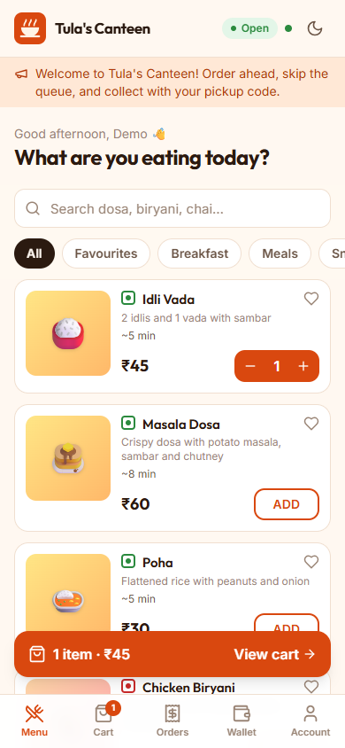
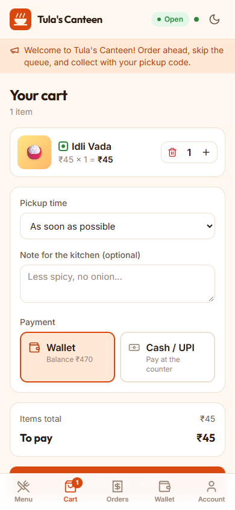
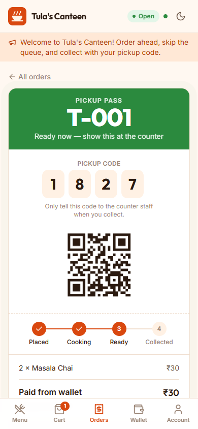
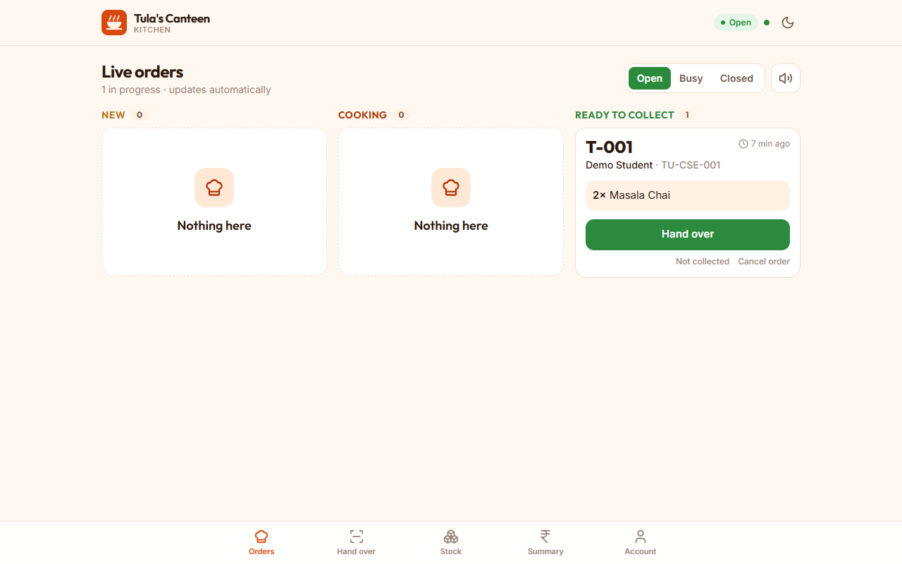
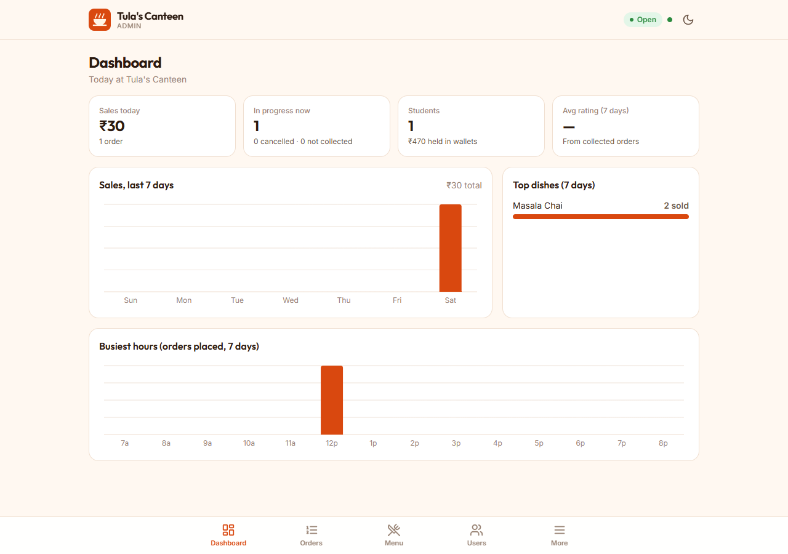

<div align="center">


# Tula's Canteen

**Order ahead. Skip the queue.**

A campus canteen pre-ordering and management system. Students order from their phone and pay from a
canteen wallet or at the counter. The kitchen gets orders on a live board, and food is handed over
by checking the student's order number and 4-digit pickup code (or scanning their QR).


</div>

<p align="center">
  
  
  
</p>
<p align="center">
  
</p>
<p align="center">
  
</p>

## Features

### Students
- Sign up and log in (JWT); edit profile and change password
- Today's menu by category, with search, a veg-only filter, favourites, ratings and "only N left" stock badges
- Cart with a **pickup time slot** (or as soon as possible) and a note for the kitchen
- Pay from the **canteen wallet** or with **cash/UPI at the counter**
- **Pickup pass** with order number (e.g. `T-017`), a 4-digit pickup code and a QR code
- **Live status** (Placed → Cooking → Ready → Collected), queue position and estimated wait, with no page refresh
- Phone notification and vibration when the food is ready
- Cancel before cooking starts (instant wallet refund); rate the order after collecting
- Wallet page with balance, full transaction history and monthly spending

### Kitchen staff
- **Live order board** (New / Cooking / Ready) that updates instantly, with a chime for new orders
- One tap to start cooking or mark ready; cancel with a reason (the student is refunded automatically)
- **Hand-over check**: scan the student's QR or type the order number and code. Wrong codes are counted
  and the order locks after 5 attempts. Manual hand-over is available for special cases.
- **Stock control**: plates left per dish, on/off for today, unlimited dishes
- Canteen switch: **Open / Busy / Closed**
- **Day summary**: cash collected, cash still to collect, wallet sales, items sold

### Admin
- **Dashboard**: today's sales, orders in progress, 7-day sales chart, busiest hours, top dishes, average rating, money held in wallets
- Menu management: add, edit and remove dishes (removed dishes keep their order history)
- User management: search, **recharge wallets**, see wallet history, block or unblock, create kitchen staff logins
- All orders with date and status filters, plus **CSV export** for Excel
- Announcements shown at the top of every student's screen
- Settings: opening hours, max orders in progress per student, max plates of one dish, no-show hold time, cash on/off

### Under the hood
- **Safe ordering under a lunch rush.** Placing an order is one database transaction: check the rules, reserve
  plates, take payment, save. Plate reservation and wallet debits are single conditional `UPDATE`s, so two
  students can never buy the last plate and a wallet can never go negative.
- **No double orders.** The app sends an `Idempotency-Key` with each checkout, so a double tap or a retry on
  bad Wi-Fi returns the same order instead of charging twice.
- **No double hand-over.** Orders use optimistic locking, so two staff phones can't both hand over the same order.
- **Wallet ledger.** Every recharge, payment and refund is recorded with the balance afterwards.
- **Live updates** with Server-Sent Events, sent only after the database change is committed.
- **Background jobs**: ready food not collected within the hold time becomes a no-show and its plates go back
  on sale; unfinished orders from earlier days are cancelled and refunded; stock resets every morning at 5 AM.
- Role-based access (Student / Staff / Admin) on every API path; blocked users are logged out immediately.
- Swagger API docs, an integration test for the whole order flow, light and dark mode, and a mobile-first layout.

## Tech stack

| Layer | Technology |
|---|---|
| Backend | Java 21, Spring Boot 3.5, Spring Security (JWT), Spring Data JPA (Hibernate), Bean Validation, springdoc OpenAPI |
| Database | MySQL 8 (production), H2 (zero-setup local runs and tests) |
| Frontend | React 19, Vite, Tailwind CSS 4, React Router, Lucide icons, `qrcode` |
| Deployment | Docker (one image with frontend and backend) and Docker Compose with MySQL |

## Run it locally

**Requirements:** JDK 21+, Maven 3.9+, Node.js 20+. MySQL is optional, since local runs use a built-in H2 database.

```bash
# 1. Backend: http://localhost:8080 (Swagger: /swagger-ui.html)
cd backend
mvn spring-boot:run

# 2. Frontend (new terminal): http://localhost:5173
cd frontend
npm install
npm run dev
```

The first start creates demo data (turn it off with `SEED_DEMO=false`):

| Role | Email | Password |
|---|---|---|
| Student (₹500 in wallet) | `student@tulas.local` | `student123` |
| Kitchen | `kitchen@tulas.local` | `kitchen123` |
| Admin | `admin@tulas.local` | `Admin@123` |

To try it on a phone, connect to the same Wi-Fi and open `http://<your-PC-IP>:5173`.

**Run with MySQL instead of H2:**

```bash
cd backend
SPRING_PROFILES_ACTIVE=mysql DB_USERNAME=root DB_PASSWORD=yourpassword mvn spring-boot:run
```

**Run the tests:**

```bash
cd backend
mvn test
```

## Deploy with Docker

```bash
cp .env.example .env      # then set real passwords and a long JWT_SECRET
docker compose up -d --build
```

The app runs on `http://localhost:8080`, with the React app served by the same server.

## Configuration

| Variable | Purpose | Default (dev only) |
|---|---|---|
| `JWT_SECRET` | Signs login tokens. Use 32+ random characters. | dev value |
| `ADMIN_EMAIL`, `ADMIN_PASSWORD` | Admin account created on first start | `admin@tulas.local` / `Admin@123` |
| `SPRING_PROFILES_ACTIVE` | `mysql` to use MySQL | H2 |
| `DB_HOST`, `DB_PORT`, `DB_NAME`, `DB_USERNAME`, `DB_PASSWORD` | MySQL connection | `localhost`, `3306`, `tulas_canteen` |
| `SEED_DEMO` | Add the demo menu and logins | `true` |
| `CORS_ORIGINS` | Allowed frontend origins (comma-separated) | `http://localhost:5173` |

**Before going live:** set a strong `ADMIN_PASSWORD` and `JWT_SECRET`, set `SEED_DEMO=false`, and serve the site over HTTPS.

## Project structure

```
backend/                     Spring Boot API
  src/main/java/com/tulas/canteen/
    domain/                  JPA entities: User, MenuItem, Order, OrderItem, WalletTxn, ...
    repo/                    Spring Data repositories (atomic stock and wallet updates)
    service/                 Business logic: OrderService, WalletService, MenuService, ReportService, LiveHub, jobs
    web/                     REST controllers: auth, student, kitchen, admin
    security/                JWT service and filter
    config/                  Security, errors, demo data, SPA hosting
  src/test/                  End-to-end API test of the order flow
frontend/                    React app
  src/pages/student|kitchen|admin
  src/components             UI kit, charts, QR code and scanner
  src/context                Auth, cart, live updates, theme
docs/screenshots/
Dockerfile, docker-compose.yml
```

## Main API endpoints

| Area | Endpoints |
|---|---|
| Auth | `POST /api/auth/register`, `POST /api/auth/login`, `GET/PUT /api/auth/me`, `POST /api/auth/password` |
| Everyone | `GET /api/menu`, `GET /api/canteen`, `GET /api/announcements`, `GET /api/live` (SSE) |
| Student | `POST /api/orders`, `GET /api/orders`, `GET /api/orders/{id}`, `POST /api/orders/{id}/cancel`, `POST /api/orders/{id}/rate`, `GET /api/wallet`, `PUT/DELETE /api/favourites/{id}` |
| Kitchen | `GET /api/kitchen/queue`, `POST /api/kitchen/orders/{id}/status`, `POST /api/kitchen/verify`, `PUT /api/kitchen/menu/{id}/stock`, `PUT /api/kitchen/status`, `GET /api/kitchen/summary` |
| Admin | `GET /api/admin/dashboard`, `/api/admin/users`, `/api/admin/users/{id}/recharge`, `/api/admin/menu`, `/api/admin/orders`, `/api/admin/orders.csv`, `/api/admin/announcements`, `/api/admin/settings` |

The full interactive docs are at `/swagger-ui.html`.

## Author

**Abhishek Raj**: [GitHub](https://github.com/Abhishek360007)
